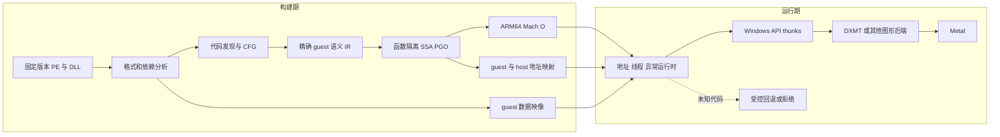

# Windows 单机游戏跨 ISA 静态翻译研究

研究日期：2026 年 10 月 27 日。目标平台为 Apple Silicon macOS；目标输入为合法获取、无需绕过 DRM 或反作弊的 Windows x86-64 单机游戏。性能优先，尽量在构建期完成翻译，最终产物为 ARM64 Mach-O 与 macOS App。当前原型使用自制样本，不包含商业游戏。

**决策：继续投入有边界的 AOT 工程实验；暂不把通用 Steam 游戏自动转换作为可交付承诺。** 已验证极小 PE 指令子集能够转换为原生 ARM64 运行，并建立原始 x86 指令的差分对照。最有希望的高性能路线是：确定的热路径做函数级 AOT，保留精确 guest 地址与状态语义，在 API 边界调用原生兼容实现。对于无法静态闭合的代码，必须明确选择“拒绝该目标”或“受控运行时回退”，不能用一次训练运行的覆盖率代替正确性。

## 工程更新与当前边界

截至 2026 年 10 月 28 日，后续开发已经超过最初 S1 原型：Remill/XED、显式 guest 内存、真实 CALL/RET、受限同步回调、文件存取、进程退出和三槽 COM 分别通过验收；本地 LLVM 15/DXMT 已完整构建，原始 Windows PE 经 ARM64 AOT 调用真实 D3D11 完成清屏、复制、全部像素回读和退出。该图形路径的 O3/O0、变基址、关键预算截断与新增标量指令差分已通过，实际 LLVM/C 插桩与 Map 清理也已通过。当前开发使用工作目录内的固定 LLVM/LLD/CMake/Ninja 和 Python 3.13，不再受初始工具缺失限制。

这些结果支持继续固定目标的工程开发，后续原 PE shader/Draw 普通矩阵也已通过，仍没有窗口输入集成、完整交互游戏或 Wine/Rosetta 游戏性能结论。固定 native DXMT 的 WSI 含 headless 和 Win32 占位，已明确需要独立窗口适配。最新状态及可复查证据以 [PROJECT.md](../PROJECT.md)、[guest 图形报告](D3D11_BRIDGE.md)、[窗口实现合同](NATIVE_WINDOW_DESIGN.md)为准；以下初始实验表保留历史口径，不用它覆盖后续结果。

## 初始 S1 实验记录

| 类别 | 已建立的证据 | 尚不能推出的结论 |
|---|---|---|
| 本机环境 | Apple M2、16 GiB；ARM64 Darwin；macOS 26.3.1；Apple Clang 16；SDK 15.2；Python 3.8；Rosetta 可用于对照组 | 不代表具备最新 ARM64 Wine 所需系统接口、签名权限或构建依赖 |
| 最小 AOT | 自制 AMD64 COFF 包成 PE32+，从 PE 字节解码、生成静态 C 控制流，再编译 ARM64 Mach-O | 不是一般 PE loader，不是整个 Windows 进程的转换 |
| S1 功能 | 五个 PE 共 31,001 组通过：三种初始样本，加上真实 Clang C 输出的 `compiled_add` 与 `compiled_checksum`；12 类预期拒绝 | 不能宣称一般 Win32、图形或游戏兼容 |
| 标志位扩展 | 32 位 ADD 与 SUB 的 CF/PF/AF/ZF/SF/OF，各 100,196 组边界及随机输入与原始 x86 字节对照，零差分 | 不是全 x86 指令集、所有 RFLAGS 或全部异常语义验证 |
| App | ad-hoc 签名 Bundle 通过验证，直接运行其中 ARM64 可执行文件成功 | 未验证 Finder 图形体验、公证或第三方分发 |
| 初始第三方研究 | 固定提交、许可证和源文件可追溯；当时只开始验证 Remill/XED | 当时的未集成状态已被后续 Remill/DXMT 证据更新；rev.ng、Wine、FEX、MoltenVK 仍没有本机游戏集成证据 |

功能证据以仓库当前的 [evidence.json](../build/evidence.json)、[flags-evidence.json](../build/flags-evidence.json) 为准，编译器生成样本、拒绝原因和当前计数均记录在那里。Rosetta 只参与独立对照程序；AOT 产物本身是 ARM64。最初在受限执行环境查询 `sysctl.proc_translated` 返回 EPERM，被记录为未知；在允许该查询的复测中五个产物及 App 均返回 0，并有 Mach-O 架构与反汇编交叉验证。

初始环境探针未找到可直接使用的 `wine`、`wine64`、`lld-link`、`cmake`、`ninja` 命令。因此 S1 用自制的小型 fixture linker 生成无 COFF 重定位的 PE；后续已取得固定工具并用标准 Clang/LLD 生成更复杂 PE。没有把工具缺失写成 Apple Silicon 环境缺失。初始探针见 [environment.json](../build/environment.json)。本次没有可用的 Windows 测试机或已配置的 Windows VM 执行完整 PE 作为 oracle；当前指令级对照依赖 Rosetta，本身也不是 x86 硬件最终裁判。

## MacNativeGames 能提供的对照

MacNativeGames 的核心优势是两端均为 ARM64。阅读的 `patch_nso.py` 实际处理 x18、TPIDR 系列寄存器、SVC、计时器访问和按构建号约束的补丁；`loader.c` 装载改写映像、设置线程槽与权限，并路由到宿主服务。项目文档描述图形侧重建NVN在Metal上的行为；本次未审计完整渲染实现。项目代码采用 MIT，游戏内容并不因此获得再分发许可。这里核查了代码结构，没有运行该项目的游戏，也不引用其 FPS 作为本方案性能证据。[ly05010419/MacNativeGames README.md](https://github.com/ly05010419/MacNativeGames/blob/aaf6ba1f494fabaa209d049e528d6f923dfe822a/README.md) [ly05010419/MacNativeGames games/by3/third_party/d2r/patch_nso.py](https://github.com/ly05010419/MacNativeGames/blob/aaf6ba1f494fabaa209d049e528d6f923dfe822a/games/by3/third_party/d2r/patch_nso.py) [ly05010419/MacNativeGames games/by3/runtime/loader.c](https://github.com/ly05010419/MacNativeGames/blob/aaf6ba1f494fabaa209d049e528d6f923dfe822a/games/by3/runtime/loader.c) [ly05010419/MacNativeGames LICENSE](https://github.com/ly05010419/MacNativeGames/blob/aaf6ba1f494fabaa209d049e528d6f923dfe822a/LICENSE)

| 问题 | Switch ARM64 到 Apple ARM64 | Windows x86-64 到 Apple ARM64 |
|---|---|---|
| 普通算术与访存 | 很多指令可保留原机器码 | 必须重建每条指令的语义与寄存器关系 |
| 指令边界 | 固定 4 字节有利于扫描 | 变长指令、嵌入数据和重叠解码增加歧义 |
| 标志位与向量 | 两端接近同一 ISA | x86 flags、部分寄存器写入、AVX 与 NEON 宽度不同 |
| 系统接口 | Horizon 服务和线程 ABI | PE、Win32/NT、TLS、SEH、COM、CRT、Windows 内存模型 |
| 游戏适配 | 仍有版本相关补丁和图形语义工作 | 同时增加跨 ISA 分析、优化和正确性成本 |

可借鉴的是“固定输入哈希、构建期重写、元数据映射、原生宿主服务、按游戏验收”的工程组织。不能将其理解为换一个 PE parser 就能得到 Windows 游戏转换器。即使同 ISA，操作系统 ABI 和图形 API 也不会自动兼容。

## 开源项目与许可核对

下表中的“可用”指适合作为候选基础或参考。最初调研时仅验证自制 Clang 链路；后续 S2 已完成 Remill/XED 的裁剪构建和受控叶函数 cross-lift，详见[当前入口](../PROJECT.md)与对应实验报告。其余候选仍不能视为已集成。固定提交列表见 [source-manifest.json](../research/source-manifest.json)。许可证应按所选提交和实际链接的组件重新核对，不能只依赖 GitHub 自动识别结果。

| 项目 | 现实能力与工程用途 | 主要限制 | 许可与集成判断 |
|---|---|---|---|
| QBDI | 动态二进制插桩；可记录指令、访存及控制流，适合目标 ISA 的观测工具 | 支持多架构不等于跨 ISA 翻译器；原项目列出信号、新线程创建和 C++ 异常限制；不提供 Windows API 层 | 主体 Apache-2.0，二进制还包含 LLVM 等依赖；适合辅助采样，不作为 AOT 引擎 |
| LLVM/Clang | IR 优化、ARM64 代码生成、Mach-O 工具链；本原型实际使用 Clang | 不能把任意 PE 直接“重新指定 target”变成正确 ARM64；需要前端语义、控制流和运行时 | Apache-2.0 WITH LLVM-exception；具体依赖和分发产物仍保留 notices |
| Remill | 指令到 LLVM bitcode；显式机器状态、内存与控制流 intrinsics；当前文档有 macOS 构建路径 | 不负责完整 PE 进程、CFG 完备性或 Win32；大 `State` 与内存 helper 可能阻碍优化 | Apache-2.0；作为语义参考与候选后端优先试验 |
| McSema | 在 Remill 之上恢复 CFG 并提升 PE/ELF；默认流程依赖 IDA Pro | 已归档；依赖和 LLVM 组合较旧；历史重编译能力不代表现代游戏到 macOS 已解决 | AGPL-3.0，IDA 另需授权；不选为新项目主干 |
| rev.ng | QEMU/LLVM 基础上的二进制分析、提升与反编译；函数隔离研究有价值 | 当前发行环境文档为 Linux x86-64，Apple Silicon 走 amd64 容器；历史 revamb 能力不能等同当前完整移植工具 | 项目整体 GPLv2，个别源码文件 MIT；须区分工具、生成代码与嵌入 runtime 的义务 |
| FEX-Emu | x86/x86-64 到 ARM64 动态执行、库调用桥接和代码缓存；适合运行时与差分参考 | 主仓库 README 仍以 ARM64 Linux 为主；macOS 路线应查看具体 Wine/CrossOver 集成，不能直接套 Linux 部署 | MIT 主体；是候选回退/基线，不是现成静态 PE 到 Mach-O 工具 |
| Box64 | Linux x86-64 用户态动态重编译、宿主库包装、持久缓存 | 平台层与 ELF、Linux ABI 紧耦合；缓存并不等于完整离线 AOT；macOS 移植成本未测 | MIT；可借鉴寄存器、flags、thunk 和块链接实现 |
| Rosetta 2 | Apple 公开资料说明存在 JIT 和 AOT 路径，已用于本实验 x86 对照组 | 专有系统组件，没有公开的通用 PE 到可分发 ARM64 App 编译 SDK | 按 Apple 系统许可使用；不能抽取当作本项目编译器或 runtime 分发 |
| Wine | 现成且广泛的 Windows 用户态 ABI/API 行为实现，覆盖 NT、Win32、线程、异常等大量细节 | CPU 翻译与 Wine 是不同层；“轻量 Wine 子集”不一定可独立裁剪，内部对象和服务器依赖很深 | LGPL-2.1-or-later；优先复用成熟子系统，保留替换/重新链接等许可证要求 |
| CrossOver | Wine 的商业集成与兼容性基线；已有 ARM64 macOS/FEX 预览的一手公告 | 商业产品与开源 Wine 不能混为同一许可；预览不是所有游戏已稳定 | 产品按其商业许可；可公开获得的开源组件按各自许可 |
| D3DMetal/GPTK | Apple 的 Windows 游戏评估环境和 DirectX 到 Metal 路线 | 未核对当前下载包的完整许可、架构接口和嵌入要求；不能假定可直接与我们的 ARM64 ABI 兼容层链接 | 专有组件；不能沿用旧版“全禁止”或社区“全可再分发”结论，当前不打包分发 |
| DXMT | D3D10/11 到 Metal；开发文档明确支持全 Mach-O `.dylib` 原生构建，也有 ARM64EC 构建配置 | 固定提交已有默认关闭的 `enable_d3d12` 选项，不能概括为没有 D3D12 代码，也不能据此推断兼容程度；原生库仍需 guest COM/vtable/调用约定桥及特定 LLVM 主版本 | 当前 LGPL-2.1-or-later；`LICENSE.OLD` 明确旧版至 v0.80 使用 MIT，不能把旧许可覆盖新代码 |
| MoltenVK | Vulkan 到 Metal 的可移植子集；适合已有 Vulkan 路线 | 不是 DirectX 实现；某些 Vulkan 特征/扩展与 Metal 有差异，不能由 Vulkan 版本号推断 DXVK/vkd3d 全兼容 | Apache-2.0；与 DXVK/vkd3d 组合前必须逐项检查功能与扩展 |
| DXVK / vkd3d-proton | 分别提供 D3D9/10/11 和 D3D12 到 Vulkan 路线 | 多一层翻译；vkd3d-proton 明确要求 Vulkan 特性及大量 descriptor indexing 能力；不能默认 MoltenVK 满足 | DXVK 为 Zlib；vkd3d-proton 为 LGPL-2.1；作为功能对照与备选 |

运行一个 GPL/AGPL 工具通常不应简单等同于“所有输出都受相同许可”；但若产物包含它的语义模板、runtime 或其他受许可代码，就必须逐项判定。动态链接也不自动免除 LGPL 的源代码、修改、替换/重新链接和 notices 义务。分发工具与分发包含商业游戏代码的生成 App 应分别管理。

项目能力与许可的一手依据：[QBDI/QBDI README.rst](https://github.com/QBDI/QBDI/blob/3318580550215a0c7a64e9c2476e02eb5fc55f14/README.rst) [QBDI/QBDI LICENSE.txt](https://github.com/QBDI/QBDI/blob/3318580550215a0c7a64e9c2476e02eb5fc55f14/LICENSE.txt)；[LLVM 代码生成](https://llvm.org/docs/CodeGenerator.html)、[LLVM 许可](https://llvm.org/docs/DeveloperPolicy.html#license)；[lifting-bits/remill README.md](https://github.com/lifting-bits/remill/blob/56918a8c2554088e93389e97d292f4035286506c/README.md) [lifting-bits/remill docs/DESIGN.md](https://github.com/lifting-bits/remill/blob/56918a8c2554088e93389e97d292f4035286506c/docs/DESIGN.md) [lifting-bits/remill LICENSE](https://github.com/lifting-bits/remill/blob/56918a8c2554088e93389e97d292f4035286506c/LICENSE)；[lifting-bits/mcsema README.md](https://github.com/lifting-bits/mcsema/blob/26368053f761be05dab708bc28fb97090c64b2be/README.md) [lifting-bits/mcsema LICENSE](https://github.com/lifting-bits/mcsema/blob/26368053f761be05dab708bc28fb97090c64b2be/LICENSE)；[revng/revng README.md](https://github.com/revng/revng/blob/352c75e3c568f188231d14a7e71e73164eef55ee/README.md)、[rev.ng 部署文档](https://docs.rev.ng/user-manual/initial-setup/)；[FEX-Emu/FEX Readme.md](https://github.com/FEX-Emu/FEX/blob/1c4f04b71a4d33091183fd7e1a2c09e6823d27fd/Readme.md) [FEX-Emu/FEX LICENSE](https://github.com/FEX-Emu/FEX/blob/1c4f04b71a4d33091183fd7e1a2c09e6823d27fd/LICENSE)；[ptitSeb/box64 README.md](https://github.com/ptitSeb/box64/blob/11a20e37c8f5996dfcd3b1f247a9b273e56ad189/README.md) [ptitSeb/box64 LICENSE](https://github.com/ptitSeb/box64/blob/11a20e37c8f5996dfcd3b1f247a9b273e56ad189/LICENSE)；[wine-mirror/wine LICENSE](https://github.com/wine-mirror/wine/blob/f343ca6085bfac807c33e9c1a8a43105071f1416/LICENSE)；[3Shain/dxmt README.md](https://github.com/3Shain/dxmt/blob/d162ea44a31fbf9089ea09977337f0beb30bd082/README.md) [3Shain/dxmt docs/DEVELOPMENT.md](https://github.com/3Shain/dxmt/blob/d162ea44a31fbf9089ea09977337f0beb30bd082/docs/DEVELOPMENT.md) [3Shain/dxmt LICENSE](https://github.com/3Shain/dxmt/blob/d162ea44a31fbf9089ea09977337f0beb30bd082/LICENSE) [3Shain/dxmt LICENSE.OLD](https://github.com/3Shain/dxmt/blob/d162ea44a31fbf9089ea09977337f0beb30bd082/LICENSE.OLD)；[KhronosGroup/MoltenVK README.md](https://github.com/KhronosGroup/MoltenVK/blob/5189f8de86ec365860f63bf1da736815cfaea5cd/README.md) [KhronosGroup/MoltenVK LICENSE](https://github.com/KhronosGroup/MoltenVK/blob/5189f8de86ec365860f63bf1da736815cfaea5cd/LICENSE)；[doitsujin/dxvk LICENSE](https://github.com/doitsujin/dxvk/blob/cbd2206d72d3d9dd9941d5d868bb03a858e85f9b/LICENSE) [HansKristian-Work/vkd3d-proton README.md](https://github.com/HansKristian-Work/vkd3d-proton/blob/dff843794e7b56b133b63bafac0f91beac273186/README.md) [HansKristian-Work/vkd3d-proton LICENSE](https://github.com/HansKristian-Work/vkd3d-proton/blob/dff843794e7b56b133b63bafac0f91beac273186/LICENSE)。

### ARM64 Wine 的新进展影响选型

Wine 开发者 Brendan Shanks 在 2026 年 8 月的公开邮件中说明，CrossOver Preview 已把 ARM64 Wine 与 FEX 的 i386/x86-64/ARM64EC 路线结合。邮件具体列出 macOS 26.5 的 x18 自定义 ABI 模式、4 KiB 页进程支持和线程级 x86 TSO 模式，及较新系统/链接器的低地址布局支持；还涉及受限 entitlement 与 provisioning。同线程 9 月回帖显示免费账户取得 entitlement 存在实际障碍，维护者尚未验证该账户路径；不能承诺任意账户都能取得。这是应加入基线的现实路线，但不表示本机 26.3.1 可以直接复现；也不应通过关闭 SIP 来推进本项目。[Wine-Devel 一手说明及后续讨论](https://list.winehq.org/hyperkitty/list/wine-devel@list.winehq.org/thread/CKG5CEN2BE5VRXZ7O7NX4YUSBH3247WH/)

Apple 官方说明 Rosetta 的通用可用范围到 macOS 27，macOS 28 起仅保留某些老游戏相关功能。因此，减少 Rosetta 依赖具有长期意义；但“游戏”这一类别本身不保证我们的自定义包装器属于保留范围。[Apple Rosetta 支持说明](https://support.apple.com/en-us/102527) Apple 对 AOT/JIT 的公开说明也表明，AOT 并非只有本方案才具备，不能单靠“提前编译”推断胜过 Rosetta。[Apple Platform Security](https://support.apple.com/guide/security/rosetta-2-on-a-mac-with-apple-silicon-secebb113be1/web)

### 论文能提供哪些工程方法

| 研究 | 可借鉴的内容 | 不应外推的能力 |
|---|---|---|
| rev.ng 2017 | 以 QEMU TCG 语义为前端、LLVM 为分析基础，恢复 CFG 与函数边界 | 不等于完整 Windows ABI、macOS loader 或现代 Steam 兼容性 |
| rev.ng 2019 | 函数隔离可改善优化，同时保留异常路径转回保守执行域 | 文中相对自身基线的收益不是对 Rosetta、Wine 或游戏的收益 |
| Multiverse 2018 | superset disassembly：保留可能的解码，以体积和映射开销换取更少启发式假设 | 项目主要是 x86 重写，不能直接当成跨 ISA PE 转译器 |
| Elevator 2026 | x86-64 到 AArch64 的全静态多解码方案；展示代码体积与完备性之间的取舍 | 当前实现仍限制多线程、C++ 异常、部分 SIMD，以及自修改/JIT；未复现其代码或验证代码许可，不能当成可直接采购的基础组件 |

[rev.ng 2017 论文](https://rev.ng/downloads/cc-2017-paper.pdf)、[rev.ng 2019 论文](https://rev.ng/downloads/bar-2019-paper.pdf)、[Multiverse 论文](https://zhiqlin.github.io/file/NDSS18a.pdf)及[代码](https://github.com/utds3lab/multiverse)、[Elevator 论文与当前限制](https://arxiv.org/html/2605.08419v1)。这些论文共同支持“需要把覆盖、状态恢复和优化一起设计”的判断，不能用论文摘要中的“完整”替代逐项查看实验范围。

## 完整技术架构

下图是拟实现的体系，当前已实现的是其中极小的 PE 解析、受限 CFG、语义提升、Clang ARM64 输出及单个 API 桥。虚线表示可选路径，不能与零运行时翻译的纯 AOT 混称。



### 构建期产物与输入契约

每个目标使用显式配置：游戏与 DLL 哈希、PE Machine 类型、支持的 API/指令集、最低系统、图形后端版本、可选 PDB、训练场景和回退政策。构建输出除 ARM64 模块外，还必须包括：guest 地址到 host 地址的映射、导入桥描述、重定位表、每个代码区域的来源、已知与未知边、guest PC 到调试信息的映射、内存区域与异常元数据，以及所有依赖的许可证清单。

程序更新、mod 或插件改变代码哈希后重新分析，不复用旧版地址补丁。资源更新可以单独缓存，但需要判断 shader、脚本和动态生成内容是否影响代码路径。不要把所有 PE 可执行节线性扫一遍就宣称转换完成。

### PE loader 与重定位

分析器处理 PE32+、节区虚拟大小与文件大小、零初始化区、导入/延迟导入、ordinal、forwarded exports、API Set、TLS 目录、load config、`.pdata/.xdata`、base relocations 和资源。先建立完整 DLL 图，再决定哪些模块整体翻译，哪些替换为原生实现。[Microsoft PE 格式](https://learn.microsoft.com/en-us/windows/win32/debug/pe-format)

运行时需要保留 guest 视角的 ImageBase/RVA 与指针语义。不能只给 `.reloc` 中的值加上 host 偏移：代码中的 RIP 相对地址、间接表、回调指针、地址运算与自省还要保持一致。建议分离 guest 代码身份与 host 可执行地址，建立可验证的映射。确定的数据区域可以使用预留地址空间加偏移；含整数化指针、32 位截断地址或低地址要求的程序需要单独策略，不能偷偷将指针替换成任意 host 地址。

第一版 loader 必须明确拒绝未实现的目录和模块类型，报告原因及 RVA。逐步加入 DIR64 重定位、IAT 绑定、延迟加载和卸载生命周期，而不是默认忽略它们。

### 静态控制流发现与间接跳转

入口、exports、异常函数表、可选 PDB 和已识别函数指针构成种子。直接分支递归解码；对 jump table、vtable、switch 和 tail call 做数据流分析。Windows x64 异常表提供有价值的函数线索，但不包含所有 leaf function，也不能证明所有指令边界。

间接分支保留 guest 目标地址，查表映射到已翻译 ARM64 块。热目标可通过 PGO 生成带目标检查的直接分支；检查失败仍走完整映射。对跨函数跳转、返回地址操作、`setjmp/longjmp`、异常和回调，要保存可重建的 guest PC/栈信息。纯 AOT 模式遇到未知目标就输出诊断并停止；混合模式才允许进入声明过的 fallback。

训练运行可以发现更多路径和目标，也可用于布局与去虚拟化；它不能证明未运行过的菜单、存档、语言包或错误路径不存在。若选择 superset 解码，应测量代码体积、I-cache 压力和地址映射成本，不能假定更完备的输出必然更快。

### 动态代码与 JIT

.NET、Mono、LuaJIT、浏览器组件、运行时 shader 编译、脚本 VM 与自修改代码需要分别识别。CPU JIT 会产生构建期不存在的 x86 字节；全静态转换无法普遍提前翻译这些未来字节。可选方案是：在授权和接口允许时使用 ARM64 原生运行时、把该目标排除，或加入可计量的动态翻译回退。

可写代码页应通过版本/哈希或写保护机制使旧译码失效，避免执行陈旧 ARM64 块。JIT 模式还涉及 macOS W^X、MAP_JIT、代码签名和线程写保护；这些要求与“CPU 指令语义正确”是两回事。第一阶段保持无 JIT，性能比较时把混合方案的编译暂停和回退比例单独记录。

### 指令语义与 LLVM 优化

先以精确状态模型建立正确性基准：16 个 GPR、RIP、RFLAGS、SIMD/x87、MXCSR、segment base 和内存访问语义。Remill 的 `State` 和 `__remill_read/write_memory_*` 分离了 guest 内存与翻译器内部状态，这一点值得沿用。其 ADD/SUB 源码明确分别处理 CF、PF、AF、ZF、SF、OF，不能把 x86 flags 简化成 ARM NZCV。[lifting-bits/remill docs/DESIGN.md](https://github.com/lifting-bits/remill/blob/56918a8c2554088e93389e97d292f4035286506c/docs/DESIGN.md) [lifting-bits/remill include/remill/Arch/X86/Runtime/State.h](https://github.com/lifting-bits/remill/blob/56918a8c2554088e93389e97d292f4035286506c/include/remill/Arch/X86/Runtime/State.h) [lifting-bits/remill lib/Arch/X86/Semantics/BINARY.cpp](https://github.com/lifting-bits/remill/blob/56918a8c2554088e93389e97d292f4035286506c/lib/Arch/X86/Semantics/BINARY.cpp)

接入 Remill 的首个门槛是验证跨目标数据布局：`State.h` 明确警告，把已有 LLVM bitcode 的 `DataLayout` 改成另一架构不能保证原有布局断言仍有效。要分别核对每个关键字段的位宽、偏移、对齐、x87 表示和 helper ABI，再执行真实字节差分。

优化层再把确定函数的状态提升为 SSA：只在跨边界处物化状态，删除死 flags，合并明确的寄存器复制，保留直接 call/branch；不要在每条指令后把全机器状态写回结构体。应避免默认给 guest 运算添加 `nsw`、`nuw`、`noalias` 或 fast-math。x86 允许的整数溢出、别名、未对齐和异常行为，不等于 C/C++ 默认优化假设。

高风险细节包括：32 位写寄存器清零高 32 位，8/16 位写保留其余位；AH 与 REX 编码限制；移位量屏蔽；INC/DEC 保留 CF；ADC/SBB 依赖旧 CF；PF 取低字节；部分 flags 在特定指令后未定义。未定义状态应按选定语义建模并检测消费者，不能以零填充隐藏缺口。

SIMD 初期支持 SSE2 的明确子集并建立位级差分。AVX/AVX2 的 256 位寄存器通常需要拆为两个 128 位 NEON 向量，还涉及 lane、上半部清零、shuffle 和 gather。不要假定 Apple Silicon 可用任意 SVE 指令。x87 的 80 位精度、舍入、NaN、异常屏蔽以及 MXCSR 的 FTZ/DAZ 必须作为独立能力项；降低精度只能成为明确配置和兼容性选择，不能用于默认高性能结果。

### 内存模型与并发

x86 TSO 比一般 ARM 内存模型强。仅把普通 `mov` 译成普通 `ldr/str` 可能让原本依赖 x86 排序的代码失败；原生 C 的数据竞争规则还可能引入编译器层面的问题。需要精确建模普通访存排序、LOCK 指令、原子 RMW、fence、未对齐/跨页原子及代码失效同步，再基于证明减少屏障。

较新 macOS 的线程级 TSO 支持是候选优化，必须满足对应 OS、entitlement 和线程生命周期约束；不能在当前环境假设它存在，也不能依赖未经支持的内部开关。先用保守软件路径建立 litmus tests 和压力测试，再考虑硬件加速。

Windows 4 KiB 页与 Apple Silicon 通常 16 KiB 页之间还存在保护粒度、guard page 和 reserve/commit 差异。单纯把四个 guest 页的权限取并集可能扩大可访问范围，不能当成完整 `VirtualProtect` 语义。需要软件页表/权限检查、可用的系统支持，或明确缩小支持范围。内存访问检查本身有性能成本，必须进入测量。

### Windows ABI 与原生 API 边界

Windows x64 参数通常走 RCX/RDX/R8/R9 或对应 XMM，包含 shadow space、栈对齐和非易失寄存器约定；Apple ARM64 具有不同寄存器、结构体、变参和栈布局。桥接必须基于函数签名生成，不能只把 RCX 复制到 x0。结构体返回、按值参数、变参、宽字符、`long` 大小、COM 对象与回调都需要明确描述。[Microsoft x64 调用约定](https://learn.microsoft.com/en-us/cpp/build/x64-calling-convention)

运行边界先固定为“内部使用 Darwin ARM64 ABI，外部显式 thunk”；如果改选 Wine/ARM64EC 的执行后端，必须重新定义进入和退出条件。ARM64EC 不是 Darwin ABI，普通 ARM64 Mach-O 不能直接跳进 ARM64EC PE 导出函数。

每个 API 桥应标明输入/输出缓冲区、句柄类型、同步与回调、错误码和生命周期。对需要长期保存的指针不能随意复制；对 host 保留的函数指针必须生成反向桥，进入正确 guest 线程/异常上下文。对已知热 API 建立直接原生入口，可减少整个 Windows DLL 的 CPU 翻译，但必须保持可见行为。

“轻量兼容层”应理解为目标驱动的最小足够实现。文件系统路径与大小写、UTF-16、registry、时间、对象等待、APC、IO completion、窗口消息、输入与音频都会扩大范围。对真实游戏，裁剪现成 Wine 子系统通常比从零模仿所有行为更有希望，但需要验证拆分边界，不能宣称 Wine 可以轻松拆成几个函数。

### TLS 与异常

Windows x64 常通过 GS 访问 TEB；PE 静态 TLS 还涉及 TLS index、初始化模板、线程 attach/detach callback、FLS 和运行库初始化顺序。应在 guest 状态中显式表达 TEB/TLS，使用宿主线程存储建立映射；不能把所有 GS 访存直接替成一个 Darwin TLS 指针。ARM64EC/Windows ARM64 的 x18 与 Apple 保留 x18 的冲突也要在选择 Wine 集成路径时解决。

x64 SEH 是 table-based，`.pdata/.xdata`、unwind code、VEH、`RtlUnwindEx`、MSVC C++ EH 与异步异常均与 guest PC/栈状态关联。LLVM 生成正常 host unwind 表不等于 Windows SEH 已实现。必须维护 host PC 到 guest PC 的映射及精确状态恢复点；信号/Mach exception 进入 host 后，需要映射成对应 guest 事件。第一次支持异常先做受控同步异常样本，再处理异步访问错误和跨 ABI unwind。

### syscall 与进程边界

Windows `syscall` 编号和 NT 内核 ABI 不能直接映射为 Darwin syscall 编号。优先在 ntdll/Win32 接口层分派到经过验证的宿主行为或 Wine 实现；裸 syscall 路径单独识别、拒绝或实现。模拟 CPUID、RDTSC/RDTSCP、线程调度和时间源时也需保持单调性及程序依赖。

程序启动器、子进程、崩溃上报、视频解码器或外部 DLL 可能引入额外 x86 依赖。最终声称“无需 Rosetta”之前，要核查 App 的全部 Mach-O 架构、运行时加载库及启动进程树，而不只检查主可执行文件。

## 图形与 Steamworks

### 图形主线

首个图形目标采用固定 D3D11 子集。优先试验 DXMT 的原生 ARM64 dylib 路径，生成 guest D3D/COM 到 host 对象的 ABI 桥。DXMT 已有原生构建说明，这是比重新实现完整 DirectX 更具体的起点；仍需要编译、链接、窗口呈现和行为验证，不能因为文档存在就宣称集成成功。源码中的 DXGI factory 仍处理 `HWND`、COM 与 WSI；要定义 guest COM 代理对象和 vtable 入口映射，先做离屏渲染，再验证窗口 swapchain。[3Shain/dxmt docs/DEVELOPMENT.md](https://github.com/3Shain/dxmt/blob/d162ea44a31fbf9089ea09977337f0beb30bd082/docs/DEVELOPMENT.md) [3Shain/dxmt build-arm64ec.txt](https://github.com/3Shain/dxmt/blob/d162ea44a31fbf9089ea09977337f0beb30bd082/build-arm64ec.txt) [3Shain/dxmt src/d3d11/d3d11_device.cpp](https://github.com/3Shain/dxmt/blob/d162ea44a31fbf9089ea09977337f0beb30bd082/src/d3d11/d3d11_device.cpp) [3Shain/dxmt src/dxgi/dxgi_factory.cpp](https://github.com/3Shain/dxmt/blob/d162ea44a31fbf9089ea09977337f0beb30bd082/src/dxgi/dxgi_factory.cpp)

后续实机前置检查已证明 M2 原生 Metal 清屏/读回可用，但尚无 DXMT 渲染。固定提交的 D3D12 构建开关默认关闭，本项目仍明确以 D3D11 为首个目标；此处纠正最初“不涵盖 D3D12”的过宽表述，不新增兼容性承诺。[DXMT meson.options](https://github.com/3Shain/dxmt/blob/d162ea44a31fbf9089ea09977337f0beb30bd082/meson.options) 实验与失败记录见[图形前置报告](GRAPHICS_PREFLIGHT.md)。

工作不止于 shader 翻译：还包括资源生命周期、格式、map/unmap、一致性、barrier、查询、同步、binding、PSO、swapchain、窗口缩放和呈现时序。CPU 构建期翻译不会自动消除运行中首次见到的 shader/PSO 编译卡顿。shader 与管线缓存以内容哈希、Metal/驱动版本和相关状态为键，冷缓存与暖缓存分开测。

D3DMetal 可作为通过其许可证允许的评估路径；目前未获取当前下载包的完整许可，不能将它默认封装进本项目发布包。Apple 官方明确把评估环境用于运行 Windows 二进制、验证 shader 与测性能；Metal Shader Converter 又是独立用途的转换工具，不能将两者的授权范围混用。[Apple GPTK 官方页面](https://developer.apple.com/games/game-porting-toolkit/)

已有 Vulkan 游戏可评估 MoltenVK；D3D9/10/11 可评估 DXVK→Vulkan→MoltenVK；D3D12 的 vkd3d-proton 路线要先验证所需 Vulkan 特征。DirectX 版本、Vulkan 版本和 Metal 版本并不是简单的兼容性等式。第一版不把 D3D12、光追或广泛商业引擎兼容作为里程碑。

### 单机游戏仍可能依赖 Steamworks

Steamworks 可能承担身份初始化、回调、成就、云存档、DLC 查询、输入、overlay 和启动检查。`steam_api64.dll` 是 x86 Windows DLL，而 macOS SDK 的动态库并非可直接按名称替换：接口版本、结构体布局、回调 ABI 与生命周期仍要适配。[Steamworks API 官方概览](https://partner.steamgames.com/doc/sdk/api)

最初样本完全不依赖 Steam。之后优先选择有公开源码、可构建 Windows 版本、无保护绕过要求、可离线执行的原生 C/C++ 程序。若某目标需要 Steam，保留合法的客户端和 SDK 路径，按官方接口做兼容验证；不通过伪造授权成功或 stub 掉所有权检查来让测试通过。是否具有游戏副本与是否能分发转换后的 App 是不同问题，本项目输出工具、测试和本地构建方法。

## 循序渐进的 MVP

| 阶段 | 输入与实现 | 验收与退出条件 |
|---|---|---|
| M0 极小闭环 | 自制 AMD64 汇编→COFF→PE，整数/分支/单 API，ARM64 App | 已有初步结果；拒绝未知指令、目录和间接目标；保留输入哈希与反汇编 |
| M1 编译器真实输出 | 用 Clang 编译自制 C 程序；扩大整数、flags 和内存语义；固定编译选项与优化级别 | 多编译器/优化级别样本；随机/边界差分；未支持模式显式失败 |
| M2 真实进程骨架 | loader 重定位、guest 栈/堆、直接调用、函数指针、TLS、文件与时间 API | Windows 或 Wine 运行原 PE 的端到端对照；ASLR、不同路径和错误路径测试 |
| M3 可交互样本 | 自制 Win32 小游戏：输入、软件绘制、保存/加载；再加入 D3D11 triangle | 画面哈希/容差、输入回放、存档字节及 30 分钟稳定运行 |
| M4 图形和性能 | DXMT 原生库、受限 D3D11 游戏场景；PGO 和热路径优化 | 相同图形后端与 workload 下比较 CPU 时间、帧时间、内存、启动和编译成本 |
| M5 单个开源游戏 | 固定 Windows 构建与资源版本，逐项声明 API、SIMD、异常、线程支持 | 启动、菜单、游玩、存档、读档、退出均通过；记录未知路径与回退 |

拥有源码的测试对象仍要通过“先生成 Windows PE，再从字节转换”路径，源码只用于构建输入与参考结果。直接把开源游戏重新编译为 macOS 是有价值的性能上界，但不能当作二进制翻译成功。

每个阶段先定义支持契约，然后扩大样本。初期允许使用自制样本来隔离问题；随着 translator 稳定，必须加入独立来源、不同编译器、不同链接布局和含优化模式的输入，避免只识别为自己写的几条指令。

## 可复现实验和结果解释

在仓库根目录执行：

```sh
python3 test_lab.py
python3 test_flags.py
python3 benchmark.py
python3 pe_aot.py build/fixtures/loop.exe build/loop-manual.c
xcrun clang -arch arm64 -O3 build/loop-manual.c runner.c -o build/loop-manual
./build/loop-manual 6
file build/fixtures/loop.exe build/loop-manual
xcrun llvm-objdump --disassemble build/loop-manual
./build/PE-AOT-Demo.app/Contents/MacOS/PE-AOT-Demo
codesign --verify --strict build/PE-AOT-Demo.app
```

`test_flags.py` 与 `benchmark.py` 使用已经安装的 Rosetta 运行独立对照程序；未安装时跳过，不安装系统组件。所有运行结果写入 `build/`。生产 AOT 程序不用 Rosetta；测试机使用 Rosetta 作为 oracle 与产物运行依赖是两件事。

### 通过和失败证据

当前五个 PE 包括 Clang 汇编生成的初始样本，以及 Clang `-O2` 从 C 生成的加法与 checksum 样本，再经小型 linker 包装为 PE32+。翻译器只读取 PE 字节，不读取汇编或 C 源码作为翻译依据。`GetCurrentProcessId` 经 IAT 识别后调用原生 `getpid()`，测试返回值与本进程 PID 相同。

当前 12 类拒绝覆盖不支持的 `UD2`、间接 `jmp rax`、消费未定义 ZF/AF、未建模的栈 flags、未初始化寄存器、跨 API 使用 volatile 寄存器、无效 shadow space、截断 PE、错误 Machine、TLS 目录和无效 IAT。拒绝是预期行为，不应计为“成功支持该程序”。各条退出码、诊断和最新计数保存在功能 JSON 中。

本原型把 PE 入口当成受控函数调用；尚未模拟 CRT、DLL 初始化和 Windows 线程入口。RSP 是受限相对偏移模型，检查调用对齐、shadow space和返回恢复，不是可寻址的完整guest栈。`PUSHFQ/POP` 探针仅用于已支持的算术 flags 取值，不代表通用 guest 栈已实现。

### 微基准的正确读法

基准把原始 COFF `.text` 字节嵌入 x86 Mach-O，用 Windows `ms_abi` 调用，并与 AOT ARM64、源码 ARM64 比较。每轮 2,000,000 次调用，7 轮交替执行；每个进程先验证 10,000 组输入，结果校验和一致。它测的是热代码局部执行，既没有 Windows loader 也没有 Wine/图形/Steam 开销。

当前完整基准中，加法中位数为 AOT 0.961 ns/调用、源码 ARM64 0.924 ns、Rosetta 1.176 ns；求和循环为 AOT 0.8585 ns、源码 ARM64 0.9035 ns、Rosetta 158.6745 ns。**循环巨大差距来自 LLVM 把循环化成闭式运算，不能把该比值用于预测游戏。** 纳秒级函数的调用 ABI、测试循环与噪声也占很大比例；只有更真实的内存、分支、SIMD 和多线程工作负载才能决定高性能路线。最新重跑值以 [benchmark.json](../build/benchmark.json) 为准。

## 与 Wine 加 Rosetta 的性能和成本比较

| 维度 | Wine 加 Rosetta | 本方案纯 AOT | AOT 加受控动态回退 | ARM64 Wine 加 FEX |
|---|---|---|---|---|
| CPU 执行 | Apple 管理的翻译与缓存 | 可以做长期优化、函数隔离和专门化；收益待测 | 热路径 AOT，冷/动态路径增加回退成本 | 动态执行及更原生的 Windows 组件；需按版本测试 |
| Windows 兼容性 | 有成熟 Wine 行为基础 | 若自建兼容层，成本最大 | 可复用成熟 runtime，但集成复杂 | 更接近现有 Wine 生态 |
| 图形 | 取决于选定后端 | 相同后端时 GPU 时间不会因 CPU AOT 自动下降 | 同左 | 同样受图形后端限制 |
| 冷启动/卡顿 | 受翻译与 shader 缓存影响 | 可消除已知 CPU 代码的首次翻译，但 shader 仍独立 | 仍有冷路径翻译暂停 | 动态代码缓存需单独测 |
| 更新成本 | 通常按版本兼容性测试 | 输入哈希变化需重分析/重建，可能重新修 CFG | 回退提高兼容性，降低静态完备要求 | 主要依赖 runtime 更新 |
| 开发成本 | 建立基线相对低；商业发行另有产品许可 | 最高，尤其异常、内存模型、ABI 和图形桥 | 介于复用与自研之间，仍是大型工程 | 新系统与 entitlement 增加环境成本 |
| Rosetta 依赖 | 有 | 目标为无，必须检查整个进程树 | 可为无，取决于 fallback 实现 | 按公开预览路线可减少/消除，具体构建待验证 |

性能应按 `帧时间 ≈ max(CPU关键路径, GPU关键路径) + 必要同步` 分析。CPU AOT 即使加速某个函数，在 GPU 已占满时也可能不提高 FPS。用串行比例的粗略 Amdahl 模型举例：若只有 30% 的关键路径可加速一倍，理论总收益约为 `1/(0.7+0.3/2)=1.18×`；这只是解释上限的假设算例，不是本项目测试结果。

开发成本按实际构建与验证记录衡量：依赖下载和构建资源、支持语义数量、失败修复、每次游戏更新的重分析成本，以及兼容层维护范围。当前没有足够目标数据估算产品成本；不以日历排期推算 AI 开发进度。受限 PoC 与多游戏长期兼容产品应分别验收，不能把局部原型完成等同于产品成熟。

性能验收使用同一设备、OS、游戏二进制、后端、画质、分辨率、输入回放和缓存状态，记录 CPU/GPU frame time、p50/p95/p99、1% low、峰值内存、代码大小、构建时间与首次进入场景暂停。比较三组：源码 ARM64上界（有源码时）、Wine+Rosetta 基线、候选 AOT；能取得合适环境时再加入 ARM64 Wine/FEX。只有统计稳定的端到端收益才支持“高性能”结论。

## 能力里程碑与停止条件

当前 AI 开发进度统一记录在 [PROJECT.md](../PROJECT.md)，详细任务见 [TASKS.md](TASKS.md)。状态依据实际代码、执行日志和验收结果更新，不使用按周路线或预估完成百分比。独立内存和 ABI 实验可并行推进；其结果不自动代表完整 PE 进程集成成功。

| 阶段 | 当前状态 | 能力范围 | 进入后续范围的门槛 |
|---|---|---|---|
| S0 调研与反证 | 已完成本轮 | 一手源码、许可、架构风险与验证方法 | 新证据出现时修订方案 |
| S1 最小 AOT | 已完成受限子集 | 自制 PE、整数/flags、受限 API、ARM64 App | 可重建、支持子集零已知差分、未知语义明确拒绝 |
| S2 成熟 lifter | 受控叶函数通过；待集成 | 固定 Remill/XED/LLVM；整数、内存、SSE2共30,000组差分 | 受限结果接入guest地址模型与真实调用链，不仅是host缓冲区 |
| S3 guest 内存 | 受限独立实验通过；待集成 | guest地址/权限、数组AOT、BSS/DIR64；尚未统一执行 | 内存契约与 AOT 接口闭合，所需重定位和地址身份正确 |
| S4 双向 ABI | 受限独立实验通过；待集成 | 四类已知签名、返回值和同步回调；再接实际PE调用 | 独立桥测试通过，并在真实 PE 路径完成往返调用 |
| S5 图形交互 | 未开始 | 原生离屏、guest 图形桥、窗口和输入 | 图像、回放、资源生命周期与错误路径可复现 |
| S6 单机目标 | 未开始 | 固定合法 Windows 构建，菜单/游戏/存档/退出 | 端到端及持续运行通过，未知路径均可解释 |
| S7 性能与交付 | 等待目标闭环 | 同后端基线、优化、包装和诊断 | 正确性不回归、性能收益可重复、产物可复现 |

S2–S4 的基础 Go 门槛是实际二进制语义、ABI、内存和错误路径闭环。仅有工具构建成功或几个算术函数不能触发图形、游戏兼容范围扩张。关键假设不成立时先修复或缩小目标，再决定是否转向成熟 ARM64 Wine/FEX 的实验集成。

S7 的高性能门槛预先设为：目标 CPU 工作负载相比同后端 Wine+Rosetta 至少有 15% 的可重复改进，且 p99 帧时间不能因 fallback 显著恶化。若只能实现 Rosetta 移除而未达性能门槛，可记录为兼容性研究成果，但不算满足本项目的高性能 Go 条件。不能看完结果再挑有利口径；所有门槛以零已知正确性回归为前提。

**当前 Go：**自制/开源受限程序、固定版本、可验证 AOT、原生 API 边界与性能研究。**当前 No-Go：**承诺任意 Steam 单机一键转换、保证完全静态覆盖任意 JIT、保证比 Rosetta 更快、或在没有完整许可与 ABI 验证时分发 D3DMetal 集成包。关键假设的反例及最小验证方法见独立 [REVIEW.md](REVIEW.md)。

本轮后续验收：原 PE Draw 的清理边界发现旧 DXMT 真实崩溃（3/3），经独立生命周期后端修复后完成九条实际普通记录与每模式 23 场景 LLVM/C 插桩，全状态流一致。该事实加强“必须按目标二进制实测”的判断，不能将独立图形库支持当作完整迁移成功。具体实现、反例、修复和约束见 [Draw 报告](DRAW_BRIDGE.md)及[独立复核](DRAW_BRIDGE_REVIEW.md)。下一真实优化窗口 PE 的寄存器间接 CALL、消息默认处理和对象生命周期缺口见 [窗口设计](WINDOW_BRIDGE_DESIGN.md)；完整 Windows 与游戏性能仍未验收。
